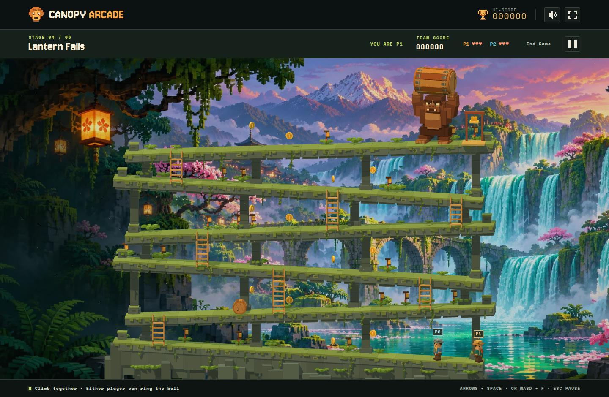

# Barrel Bound

A six-stage Three.js arcade climb. Play solo, share a keyboard, or play on two computers over your home network.



## Run locally

Use Node.js 20.19+ or 22.12+ and a browser with WebGL 2.

```sh
npm ci
npm start
```

The host builds the game and serves it on port 4175. Open **[the title screen](http://127.0.0.1:4175/)** on the host computer. **Play Solo** starts a fresh one-player run, and **Share Keyboard** starts two climbers on this computer. All fonts and art are served locally, and the browser synthesizes the music and sound effects.

## Two computers on the same network

Run **one** host with `npm start` (or `npm run lan`). Leave that terminal running. Open the network address printed by that host on both computers; starting a host on each computer creates separate games. Under **Two computers · LAN**, choose the same mode on each screen. The first player chooses the starting stage. Copy the cabinet link from the waiting screen and open it on the other computer to join the matching mode.

- **Climb Together** puts two climbers on the same stage. Either of you can click **Start Co-op** when both have joined. Each keyboard drives its own climber. You share the score, keep separate lives, and either climber can ring the bell. A teammate who runs out of lives rejoins the next stage with one life.
- **Take Turns** gives each player a separate run. P1 clicks **Start Turn**, and the other player watches live. A lost life or a bell passes control. Each player's stage, lives, checkpoint, and score carry over between turns. The higher score wins.

On either computer, use the arrow keys and Space, or WASD and F. Esc or P pauses and resumes; in Take Turns, the active player controls pause and resume. Switching away from the game also pauses it. If controls stop arriving over the network, the host pauses within 1.5 seconds.

A disconnect pauses the game and reserves that seat for two minutes. Reloading the same tab reconnects to the same paused run; resume when both players are back. Progress lives in the running host, so restarting the host ends the match. Either player can choose **End Game** to release both seats and return both browsers to the main menu. Finishing a match releases the seats immediately and leaves the final score on each screen. Selecting a mode for a new game starts with fresh lives, scores, hazards and checkpoints. To play alone again, choose **Play Solo**. In a local game, use **Esc → Main Menu → Play Solo**.

If one screen keeps waiting, check that both computers opened the same host address and selected the same LAN mode. Allow the host through your computer's firewall for your home network. The default port is 4175; set `BARREL_PORT` to choose another. Keep LAN hosting on your trusted home network.

## Controls

| Action | Player 1 | Player 2 |
| --- | --- | --- |
| Move | Left / Right | A / D |
| Climb a ladder | Up / Down | W / S |
| Jump | Space | F |
| Pause | Esc or P | Esc or P |

Solo mode also accepts the second key layout and has on-screen controls on touch devices. Select **Share Keyboard** on the title screen for simultaneous local co-op.

## Play

Reach the golden bell on the highest platform. Some barrels turn at ladder openings, roll down the rungs, and continue across the lower floor. Coins earn 50 points, jumping a barrel earns 100, and reaching a higher floor earns 100. Faster clears earn a larger time bonus. The highest ladder reached becomes each explorer's respawn checkpoint.

The mines have flame vents that flash before firing. On Frostfall Peak, braking takes longer and shimmering ice warns of falling icicles. Each player starts with three lives. Either co-op player can finish the stage. A partner who ran out of lives rejoins the next stage with one life.

High scores and sound preferences are saved in the current browser.

The stages are Jungle Ruins, Ember Mines, Frostfall Peak, Lantern Falls, Crystal Grotto, and Clockwork Harbor. The last three add alternate ladders that both explorers and barrels can use.

## Production build

```sh
npm run build
npm run preview
```

The finished static game is in `dist/`. Scene geometry, characters, and barrel animation are in `src/world.js`. Movement and collisions are in `src/game.js`, and stage layouts are in `src/levels.js`.

## Checks

```sh
npm test
npx playwright install chromium
npm run test:browser
```

The Node tests cover the simulation, browser connection lifecycle, and real WebSocket matches. The browser check launches two independent Chromium browsers and exercises solo, shared keyboard, LAN co-op, alternating turns, reloads, pause, end game and results. Screenshots and results go into the ignored `artifacts/browser/` folder. Linux CI uses `npx playwright install --with-deps chromium` to install browser system dependencies as well.

GitHub Actions runs the Node tests and production build on Node 20, 22 and 24, plus the browser check on Node 22. See [the LAN review](docs/LAN_REVIEW.md) for the state lifecycle and regression coverage.

<details>
<summary>Artwork and generation prompts</summary>

The built-in ImageGen tool created the title art and scenic backdrops. Each stage thumbnail is a crop of its title art. The playable 3D characters, platforms and props are generated from geometry in the game.

**[Jungle Ruins title art](public/art/jungle.webp)**

Use case: stylized-concept. Premium illustrated key art background for an original 3D voxel arcade platform game. Very wide panoramic landscape 2.6:1 composition. Artwork only, absolutely no words, text, logo, labels, UI, frames, or graphic overlay. A spectacular detailed voxel diorama of ancient overgrown jungle ruins. Main action ENTIRELY in the RIGHT 62% of frame. Left 38% is spacious deep shadowy petrol-green jungle, with a few faint layers of trees, destined for typography. On right, a huge expressive chunky dark-chocolate brown voxel gorilla with warm caramel muzzle, fierce brows and blocky cream teeth, facing us at a 3/4 view, holding a horizontal big wooden barrel with two iron hoops over his head with both hands. His whole silhouette including barrel is beautifully framed inside the image, not cropped. He stands on the highest of three staggered, heavily moss-covered block-built temple platforms. A tiny charming blocky explorer in a golden brimmed hat, red neckerchief and teal jacket on a lower platform is facing him. Vine-strung blocky rock terraces, ladders, a rolling barrel, ferns, hanging vines and carved ruins at right, tiny golden motes. Behind is a deep turquoise misty rain forest with immense layered jungle trees and honey-gold shafts of afternoon sunlight descending from top right. Rich stylized 3D voxel key art, tactile intricate cubes and rectangular geometry, crisp hard chamfered edges, AO, warm directional rim lighting, beautifully art directed pixel art game poster. Keep light levels on the artwork vivid and vibrant, with lush emerald, lime, deep teal, golden ochre, mahogany. No flat vector, no mockup, no surrounding page, no text.

**[Ember Mines title art](public/art/mine.webp)**

Premium game key art background, stylish intricate 3D voxel block diorama in a very wide 2.6:1 landscape frame, absolutely no text, lettering, symbols or UI. Stage is Ember Mines, an abandoned volcanic mine, chunky basalt caverns, wooden mine-cart rails, carts, orange hot lava trickling through black stones, golden lanterns, fiery ember sparks, copper ore, wooden beam supports and diagonally braced scaffolding. Left 38 percent of frame is in very deep atmospheric empty shadow for menu text. On right, three staggered block-built climbable platforms linked by wooden ladders. On top of the rightmost platform, a large blocky dark brown gorilla with tan muzzle, fists, expressive brows holding a wooden barrel over his head. Small golden-hatted adventurer in teal jacket and red scarf on the lower platform looking toward him. Zoomed out enough to see a full world with strong silhouette. Richly detailed small bevel blocks, cinematic lighting, tactile shadows, beautiful premium isometric voxel game poster rendered in 3D. Palette burnt orange, deep claret, molten amber, black basalt. No text or logos.

**[Frostfall Peak title art](public/art/frost.webp)**

Premium game key art background, stylish intricate 3D voxel block diorama in a very wide 2.6:1 landscape frame, absolutely no text, lettering, symbols or UI. Stage is Frostfall Peak, high alpine icy peaks, an ice-carved blue medieval watchtower, snow-covered conifers, snow crusted suspended block-stone paths, frosty indigo chasms, warm-lit windows and a glowing summit beacon in the blue hour. Left 38 percent of frame is in very deep atmospheric empty shadow for menu text. On right, three staggered block-built climbable platforms linked by wooden ladders. On top of the rightmost platform, a large blocky dark brown gorilla with tan muzzle, fists, expressive brows holding a wooden barrel over his head. Small golden-hatted adventurer in teal jacket and red scarf on the lower platform looking toward him. Zoomed out enough to see a full world with strong silhouette. Richly detailed small bevel blocks, cinematic lighting, tactile shadows, beautiful premium isometric voxel game poster rendered in 3D. Palette electric ice blue, dusty lavender, indigo, winter moonlight. No text or logos.

**[Jungle Ruins playfield backdrop](public/art/jungle-valley.webp)**

Use case: stylized-concept. Panoramic 2.3:1 landscape environment BACKDROP for a side-view 3D voxel arcade game. a spectacular layered emerald and turquoise ancient jungle valley, giant mossy kapok trees and carved stone ruins framing the sides, a narrow distant waterfall on the far left, warm sunlight piercing a misty canopy, thick tropical broadleaves, elegant depth and golden rays, warm lush green and dark petrol teal. Create beautifully textured premium 3D voxel game art, thousands of fine small cubes with crisp geometric facets, cinematic atmosphere, a lively beautiful environment in deep perspective. Compose as a background plate: distant landscape fills entire frame, lively silhouettes to far left and right, center is a quieter broad open expanse of distant scenery with softer contrasts, suitable for separate game characters and platforms overlaid on top. Wide-angle scenic vista. There is no big foreground block or flat gameplay floor. No characters, no gorilla, no barrels, no coins, no ladders, no level platforms, absolutely no text, no user interface or framing. Beautiful readable surroundings, with a soft rim light and delicate volumetric haze.

**[Ember Mines playfield backdrop](public/art/mine-valley.webp)**

Use case: stylized-concept. Panoramic 2.3:1 landscape environment BACKDROP for a side-view 3D voxel arcade game. a huge atmospheric underground copper mine, deep maroon basalt cliffs, a few minuscule glowing amber lanterns, distant timber built mining galleries on the far sides, distant thin streams of orange lava, light dusty violet haze in a shadowy huge cavern, rich warm copper and burnt amber. Create beautifully textured premium 3D voxel game art, thousands of fine small cubes with crisp geometric facets, cinematic atmosphere, a lively beautiful environment in deep perspective. Compose as a background plate: distant landscape fills entire frame, lively silhouettes to far left and right, center is a quieter broad open expanse of distant scenery with softer contrasts, suitable for separate game characters and platforms overlaid on top. Wide-angle scenic vista. There is no big foreground block or flat gameplay floor. No characters, no gorilla, no barrels, no coins, no ladders, no level platforms, absolutely no text, no user interface or framing. Beautiful readable surroundings, with a soft rim light and delicate volumetric haze.

**[Frostfall Peak playfield backdrop](public/art/frost-valley.webp)**

Use case: stylized-concept. Panoramic 2.3:1 landscape environment BACKDROP for a side-view 3D voxel arcade game. a snowy mountain valley high above the clouds at early winter twilight, glacial blue peaks, soft warm light touching distant lavender high spires, snow-mantled pines flanking the left and right edges, distant ancient stone arch bridges disappearing into mist, cyan sapphire and lilac. Create beautifully textured premium 3D voxel game art, thousands of fine small cubes with crisp geometric facets, cinematic atmosphere, a lively beautiful environment in deep perspective. Compose as a background plate: distant landscape fills entire frame, lively silhouettes to far left and right, center is a quieter broad open expanse of distant scenery with softer contrasts, suitable for separate game characters and platforms overlaid on top. Wide-angle scenic vista. There is no big foreground block or flat gameplay floor. No characters, no gorilla, no barrels, no coins, no ladders, no level platforms, absolutely no text, no user interface or framing. Beautiful readable surroundings, with a soft rim light and delicate volumetric haze.

**[Lantern Falls backdrop](public/art/falls.webp)**

Use case: stylized-concept. Premium panoramic 2.6:1 wide landscape background painting for a 3D voxel platform game named Lantern Falls. Illustrate lush Japanese mountain rainforest and ancient stone viaducts; huge tiers of turquoise waterfalls cascade from fern-covered cliffs in the distance; small warm paper lanterns, blossom-pink treetops, a faraway vermilion torii arch on the upper right ridge at twilight. Emerald teal water, pink petals, luminous golden amber lanterns. Richly textured small block built voxel diorama, gorgeous layered painterly atmospheric depth, bevel highlights, cinematic side lighting. Wide establishing shot, intricate recognizable silhouettes, beautiful readable surroundings. Left third of the composition is deeply shadowed as a natural place for title text that will be added separately, center is a broad open view through soft mist and the scene's signature landmark is on the right. Art only, absolutely no text or UI, no main characters or gorillas or barrels, no foreground gameplay platforms or ladders. A scenic vista that can serve both as playable level backdrop and chapter title art.

**[Crystal Grotto backdrop](public/art/grotto.webp)**

Use case: stylized-concept. Premium panoramic 2.6:1 wide landscape background painting for a 3D voxel platform game named Crystal Grotto. Illustrate a gigantic subterranean cathedral of amethyst and sapphire crystal, flooded with luminous blue water. Towering crystalline forms and lush little bioluminescent plants frame indigo geodes at the far sides, intricate hidden dwarven ruin details on the right, glowing pink mineral veins and misty distant arches. Amethyst purple, icy cyan, fuchsia, deep blue. Richly textured small block built voxel diorama, gorgeous layered painterly atmospheric depth, bevel highlights, cinematic side lighting. Wide establishing shot, intricate recognizable silhouettes, beautiful readable surroundings. Left third of the composition is deeply shadowed as a natural place for title text that will be added separately, center is a broad open view through soft mist and the scene's signature landmark is on the right. Art only, absolutely no text or UI, no main characters or gorillas or barrels, no foreground gameplay platforms or ladders. A scenic vista that can serve both as playable level backdrop and chapter title art.

**[Clockwork Harbor backdrop](public/art/harbor.webp)**

Use case: stylized-concept. Premium panoramic 2.6:1 wide landscape background painting for a 3D voxel platform game named Clockwork Harbor. Illustrate a sprawling sunset steampunk sky harbor built along coastal cliffs, distant terraced brass foundries, copper airships with delicate rigging, monumental clocktower, waterwheels and gears at far right, glowing windows, small ships and seagulls. Amber golden sunset through apricot clouds, dark blue teal sea and copper roofs. Richly textured small block built voxel diorama, gorgeous layered painterly atmospheric depth, bevel highlights, cinematic side lighting. Wide establishing shot, intricate recognizable silhouettes, beautiful readable surroundings. Left third of the composition is deeply shadowed as a natural place for title text that will be added separately, center is a broad open view through soft mist and the scene's signature landmark is on the right. Art only, absolutely no text or UI, no main characters or gorillas or barrels, no foreground gameplay platforms or ladders. A scenic vista that can serve both as playable level backdrop and chapter title art.

</details>

